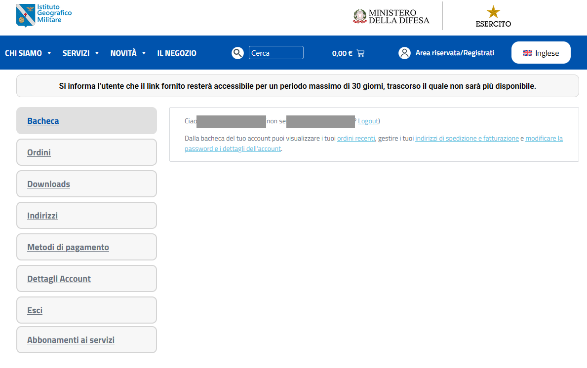
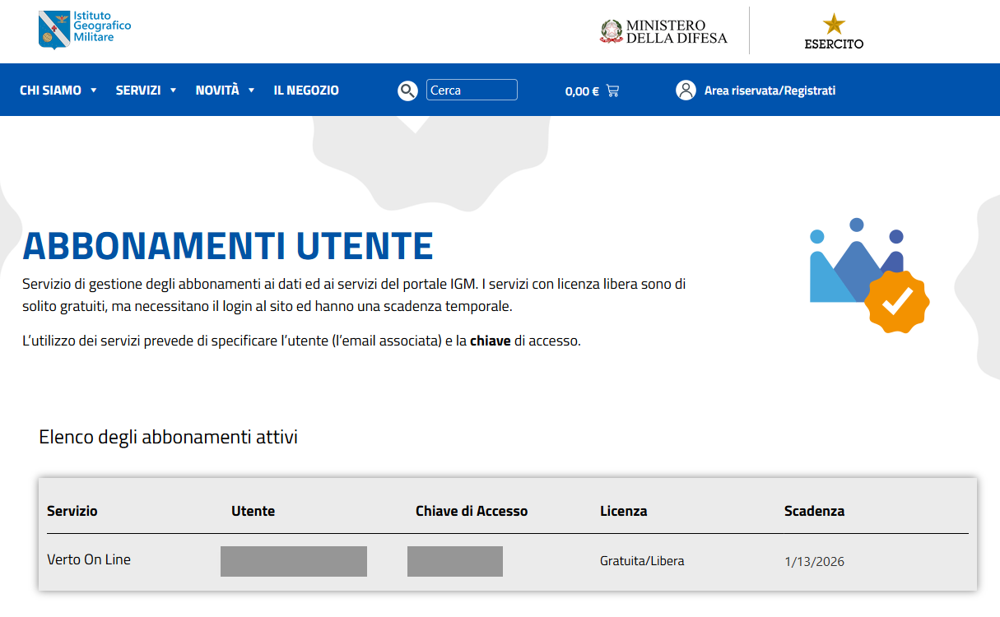

# Riferimento CLI

Guida completa ai comandi e alle opzioni di `openverto`. Per l'avvio rapido vedi il [README](../README.md).

---

## Ordine degli assi

Tutte le coordinate seguono la convenzione **est (e) prima, nord (n) dopo**.

- Sistemi proiettati: `e` = easting (m), `n` = northing (m)
- Sistemi geografici: `e` = longitudine (gradi decimali), `n` = latitudine (gradi decimali)

> **Attenzione**: per i CRS geografici (4265, 4230, 4670, 6706) questo è l'**inverso** dell'ordine lat/long del registro EPSG. Passa sempre la longitudine per prima. Le posizioni GeoJSON (x, y) corrispondono già a (e, n) e non richiedono alcuno scambio.

---

## Opzioni globali

Le opzioni globali vanno **prima** del sottocomando:

```bash
openverto [OPZIONI GLOBALI] <comando> [OPZIONI COMANDO]
```

| Opzione | Default | Descrizione |
|---|---|---|
| `-o / --output` | `table` | Formato di output: `table`, `json`, `jsonl`, `csv` |
| `--timeout` | `30.0` | Timeout per ogni richiesta HTTP (secondi) |
| `-k / --insecure` | disattivato | Salta la verifica del certificato TLS per tutte le richieste dell'invocazione (non sicuro) |
| `--throttle` | `2.0` | Pausa tra batch consecutivi nei job con più di 32 000 coordinate (secondi); `0` per disabilitare |
| `-H / --header` | — | Header HTTP aggiuntivo `Nome: Valore` (ripetibile) |
| `--utente` | `OPENVERTO_UTENTE` | Utente IGM, l'email dell'account |
| `--chiave` | `OPENVERTO_CHIAVE` | Chiave di accesso IGM; meglio la variabile, così non resta nella cronologia della shell |
| `-V / --version` | — | Mostra la versione ed esce |

### Formati di output

```bash
openverto systems                   # tabella Rich (default in terminale)
openverto -o json systems           # JSON indentato
openverto -o jsonl convert ...      # JSON Lines: un oggetto per riga (ideale per pipeline)
openverto -o csv convert ...        # CSV con intestazione
```

`jsonl` è il formato più adatto allo streaming verso `jq` o altri strumenti di linea.

### Verifica SSL/TLS

La verifica del certificato è attiva per default, senza fallback automatico.
Per saltarla esplicitamente (ad esempio con certificato IGM scaduto):

```bash
openverto --insecure convert --from 4265 --to 6706 --no-cache 12.4924 41.8902
```

`-k` è equivalente a `--insecure`. Il flag vale per tutti i comandi di rete,
solo nell'invocazione corrente. **Non garantisce l'identità del server**:
coordinate e credenziali possono essere intercettate tramite impersonificazione.
Usalo solo se accetti questo rischio.

### Throttle e batch

`--throttle` interviene **solo** quando un job supera le 32 000 coordinate per richiesta (il limite del servizio IGM). Una singola richiesta non viene mai rallentata. Aumenta il valore se il servizio restituisce errori temporanei su job molto grandi.

---

## Credenziali IGM

Il servizio è gratuito, ma IGM ha annunciato che dal 1° novembre 2026 è riservato agli utenti registrati. Al 6 novembre 2026 il controllo non risulta ancora attivo, e senza credenziali openverto invia un valore segnaposto.

1. Accedi al [sito IGM](https://igmi.esercito.difesa.it/) con il tuo account, da "Area riservata/Registrati".
2. Apri "Abbonamenti ai servizi".

   

3. Copia i valori della riga "Verto On Line": la colonna "Utente" è l'email dell'account, "Chiave di Accesso" è la chiave.

   

4. Imposta le due variabili:

```bash
export OPENVERTO_UTENTE="nome@esempio.it"
export OPENVERTO_CHIAVE="la-tua-chiave"
```

Le credenziali scadono ogni 3 mesi: i nuovi valori si trovano nella stessa pagina. L'ordine di precedenza è `--utente`/`--chiave`, poi le variabili, poi il segnaposto. Le coordinate già presenti nella cache locale non passano dal servizio e non usano le credenziali.

## Codici RDN2008 cambiati

Il servizio IGM non accetta più 6707, 6708, 6709 e 6876: al loro posto ci sono 7791, 7792, 7793 e 7795, che secondo la [nota EPSG di IGM](https://igmi.esercito.difesa.it/wp-content/uploads/nuova_nota_EPSG.pdf) sono gli stessi sistemi con l'ordine degli assi Est, Nord. Su 12 punti già convertiti in precedenza con 6707 e 6708, 7791 e 7792 danno lo stesso risultato. Con un codice vecchio openverto esce con un errore che indica quello da usare.

## Codici di uscita

| Codice | Significato |
|---|---|
| `0` | Successo |
| `2` | Errore d'uso (parametri errati, coordinata fuori griglia, credenziali rifiutate) |
| `3` | EPSG non trovato nel catalogo IGM, o non più accettato dal servizio |
| `5` | Errore del servizio o di rete |

---

## Comandi

### `systems` — sistemi di riferimento supportati

```bash
openverto systems [--refresh]
```

Elenca i 20 sistemi di riferimento italiani supportati da Verto Online (EPSG + descrizione). Il risultato è memorizzato in cache offline dopo la prima chiamata.

| Opzione | Descrizione |
|---|---|
| `--refresh` | Forza il recupero live ignorando la cache |

**Esempi**

```bash
openverto systems
openverto -o jsonl systems
openverto systems --refresh
```

---

### `convert` — conversione di coordinate

```bash
openverto convert --from <EPSG> --to <EPSG> [e n ...]
```

Converte una o più coppie di coordinate. Le coppie si passano come argomenti posizionali; in alternativa si leggono da stdin nel formato `e,n` (una coppia per riga).

| Opzione | Descrizione |
|---|---|
| `--from` | EPSG di origine (obbligatorio) |
| `--to` | EPSG di destinazione (obbligatorio) |
| `--no-cache` | Ignora la cache delle conversioni già effettuate |

**Esempi**

```bash
# singola coordinata geografica Roma40 → RDN2008
openverto convert --from 4265 --to 6706 12.4924 41.8902

# proiettata UTM33 → RDN2008 con output JSON Lines
openverto -o jsonl convert --from 23033 --to 6706 290000 4640000

# più coppie in un colpo solo
openverto convert --from 3003 --to 7791 1500000 4640000 1510000 4650000

# da stdin
printf '290000,4640000\n291000,4641000\n' | openverto -o csv convert --from 23033 --to 6706
```

> Se la coordinata cade fuori dalla copertura della griglia IGM (Italia e mari circostanti), il servizio restituisce un errore. Usa `detect` e `inspect` per verificare EPSG e ordine degli assi prima di convertire.

---

### `batch` — conversione di un CSV

```bash
openverto batch <file> --from <EPSG> --to <EPSG> [OPZIONI]
```

Converte un intero CSV di coordinate. Il file è letto con DuckDB: il delimitatore (`,`, `;`, tab, `|`) viene rilevato automaticamente. Usa `-` come file per leggere da stdin.

| Opzione | Default | Descrizione |
|---|---|---|
| `--from` | — | EPSG di origine (obbligatorio) |
| `--to` | — | EPSG di destinazione (obbligatorio) |
| `--e-col` | auto | Nome della colonna est/longitudine (rilevato dai nomi comuni se omesso) |
| `--n-col` | auto | Nome della colonna nord/latitudine (rilevato dai nomi comuni se omesso) |
| `--decimal` | `.` | Separatore decimale del CSV: `.` oppure `,` (italiano, es. `12,4924`) |
| `--out` | stdout | File di output |
| `--format` | `csv` | Formato di output: `csv` oppure `geojson` |
| `--skip-invalid` | off | Isola e salta le coordinate che il servizio rifiuta (biseziona il batch) |
| `--rejects` | — | Salva le righe saltate in questo file CSV |

#### Comportamento del servizio con coordinate non valide

Il servizio IGM è **tutto-o-niente** per ogni richiesta: se anche una sola coordinata è fuori dalla copertura della griglia, l'intera richiesta fallisce.

- **Senza `--skip-invalid`** (default): se una qualsiasi coordinata è fuori griglia, il comando termina con errore e nessun risultato viene scritto.
- **Con `--skip-invalid`**: il batch viene bisecato ricorsivamente fino a isolare i singoli punti problematici. I punti validi vengono convertiti normalmente; quelli rifiutati sono esclusi dall'output (e facoltativamente salvati con `--rejects`).

```bash
# 500 punti, 20 fuori Italia: i 480 validi vengono salvati, i 20 esclusi riportati su stderr
openverto batch punti.csv --from 4265 --to 6706 --skip-invalid

# salva anche le righe scartate in un file separato
openverto batch punti.csv --from 4265 --to 6706 --skip-invalid --rejects fuori_griglia.csv
```

#### Output strutturato

Con `-o json`, `-o jsonl` o `-o csv`, l'output va sempre su **stdout** e le opzioni `--out` e `--format` vengono ignorate.

```bash
openverto -o jsonl batch catasto.csv --from 3003 --to 7791 --e-col est --n-col nord
```

**Altri esempi**

```bash
# CSV all'italiana (virgola decimale)
openverto batch comuni.csv --from 4265 --to 6706 --decimal , --e-col lon --n-col lat

# output GeoJSON su file
openverto batch points.csv --from 3003 --to 6706 --format geojson --out out.geojson

# da stdin verso stdout
cat comuni.csv | openverto batch - --from 4265 --to 6706 --decimal ,
```

#### Stimare la qualità della conversione

Il servizio IGM non restituisce metriche di errore per punto. Per stimare la qualità dopo un `batch`, usa `roundtrip` su un campione del file originale: converte A→B→A e riporta il residuo in metri per ogni punto.

```bash
# campiona 20 righe casuali e verifica il roundtrip (richiede DuckDB)
duckdb -c "COPY (SELECT x, y FROM read_csv_auto('input.csv') USING SAMPLE 20) TO '/dev/stdout' (HEADER false)" \
  | openverto roundtrip --from 23033 --to 7792
```

---

### `geojson` — riproiezione di un file GeoJSON

```bash
openverto geojson <file> --from <EPSG> --to <EPSG> [--out <file>]
```

Riproietta tutte le coordinate delle geometrie di un file GeoJSON. Le posizioni GeoJSON (x, y) corrispondono già a (e, n): nessuno scambio di assi necessario. Usa `-` per leggere da stdin.

| Opzione | Descrizione |
|---|---|
| `--from` | EPSG di origine delle posizioni nel file (obbligatorio) |
| `--to` | EPSG di destinazione (obbligatorio) |
| `--out` | File di output (default: stdout) |

**Esempi**

```bash
openverto geojson aree.geojson --from 4230 --to 6706 --out out.geojson
cat aree.geojson | openverto geojson - --from 4230 --to 6706
```

---

### `inspect` — metadati di un EPSG

```bash
openverto inspect <EPSG> [<EPSG> ...]
```

Mostra famiglia datum, ordine degli assi, unità, fuso e false easting per uno o più EPSG. Utile per disambiguare sistemi simili (es. 3003 vs 3004) prima di una conversione.

**Esempi**

```bash
openverto inspect 3003
openverto -o json inspect 3003 6706
```

---

### `detect` — indovina il sistema di riferimento

```bash
openverto detect <e> <n>
```

Indovina il sistema di riferimento probabile di una coordinata basandosi sulla sua magnitudine. Utile quando un dataset è etichettato vagamente ("UTM", "Gauss-Boaga") senza EPSG esplicito.

**Esempi**

```bash
openverto detect 290000 4640000
openverto -o json detect 1500000 4640000
```

---

### `targets` — destinazioni valide per una conversione

```bash
openverto targets <EPSG>
```

Elenca i sistemi di riferimento verso cui è possibile convertire un dato EPSG. Le conversioni tra sistemi con lo stesso datum sono rifiutate dal servizio: questo comando mostra solo le destinazioni con datum diverso.

**Esempi**

```bash
openverto targets 3003
openverto -o csv targets 3003
```

---

### `roundtrip` — verifica la reversibilità di una catena datum

```bash
openverto roundtrip --from <EPSG> --to <EPSG> [e n ...]
```

Esegue la conversione A→B→A e riporta l'errore residuo (Δe, Δn, distanza in metri). Permette di certificare che una catena di datum sia lossless entro tolleranza prima di pubblicare dati.

**Esempi**

```bash
openverto roundtrip --from 23033 --to 6706 290000 4640000
openverto -o json roundtrip --from 3003 --to 7791 1500000 4640000
```

---

### `grid` - griglia di spostamento per GDAL e PROJ

Costruisce una griglia di spostamento orizzontale (GeoTIFF nel formato griglie di PROJ) campionando Verto Online sui nodi di un reticolo regolare. Le griglie sono solo 2D: latitudine e longitudine, nessuna quota. Esempi per riproiettare un raster con `gdalwarp` nel [README](../README.md).

```bash
openverto grid --from 4265 --to 6706 --bbox 11 43.5 12 44 --dry-run
openverto grid --from 4265 --to 6706 --bbox 11 43.5 12 44 --out roma40_rdn2008.tif
```

| Opzione | Default | Descrizione |
|---|---|---|
| `--from`, `--to` | obbligatorie | EPSG geografici di Verto, di datum diversi: 4265, 4230, 4670, 6706 |
| `--bbox` | obbligatoria | Ovest sud est nord, in gradi del sistema di partenza; tutto dentro la copertura IGM |
| `--step-lon`, `--step-lat` | `450`, `300` | Passo in secondi d'arco (7,5' x 5') |
| `--origin-lon`, `--origin-lat` | nodi IGM con il passo IGM, altrimenti angolo del bbox | Punto a cui allineare il reticolo |
| `--out` | obbligatoria senza `--dry-run` | GeoTIFF di uscita; accanto scrive `<out>.report.json` |
| `--pause` | `2` | Secondi fra una richiesta e l'altra |
| `--cache-dir` | cache di openverto | Cartella dei batch già riusciti |
| `--dry-run` | no | Stampa nodi, richieste e tempo stimato, senza chiamare il servizio |
| `--yes` | no | Conferma un lavoro sopra le 10 richieste |

Se un nodo cade fuori copertura la richiesta fallisce, non viene scritta nessuna griglia e il comando esce con codice 2. Il `--bbox` va ristretto.

### `cache` — gestione della cache offline

```bash
openverto cache [--stats] [--clear]
```

La cache memorizza le risposte del servizio IGM per permettere pipeline riproducibili offline (es. in CI). La cache dei sistemi di riferimento viene aggiornata automaticamente; quella delle conversioni cresce con l'uso.

| Opzione | Descrizione |
|---|---|
| `--stats` | Mostra le statistiche della cache (percorso, numero di voci, dimensione) |
| `--clear` | Elimina la cache dei sistemi e delle conversioni |

**Esempi**

```bash
openverto cache --stats
openverto cache --clear
```

---

### `doctor` — verifica la connettività

```bash
openverto doctor
```

Verifica la raggiungibilità del servizio IGM Verto Online e riporta il numero di sistemi disponibili.

**Esempi**

```bash
openverto doctor
openverto -o json doctor
```
